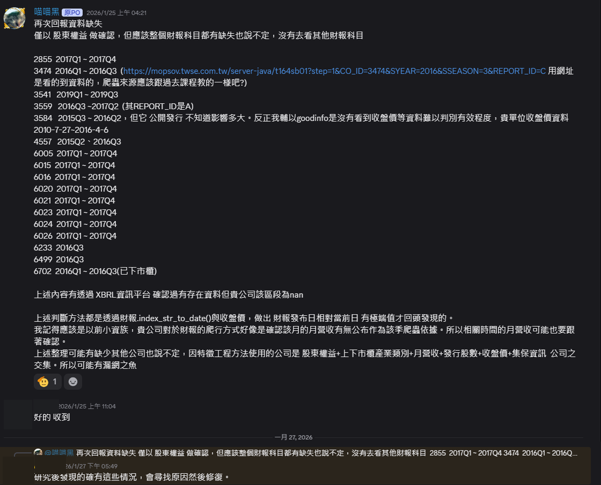
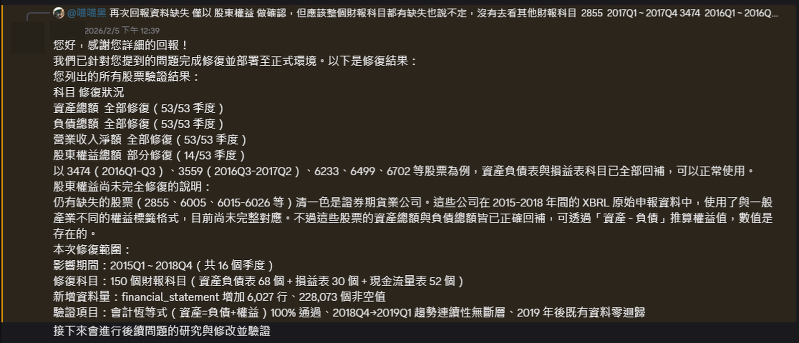
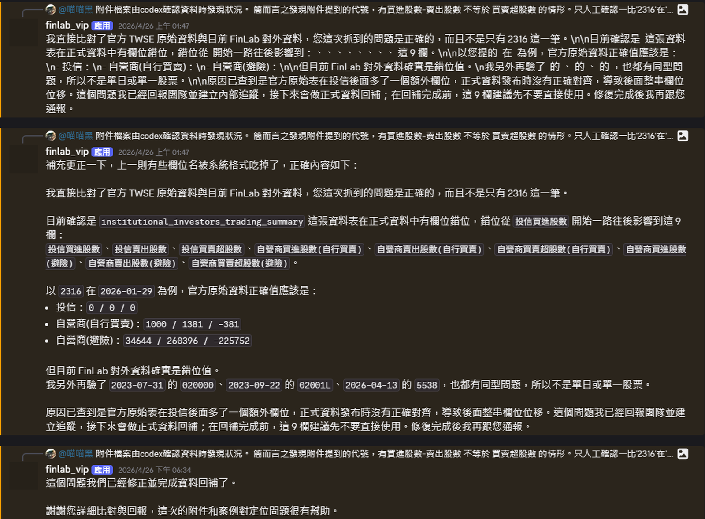
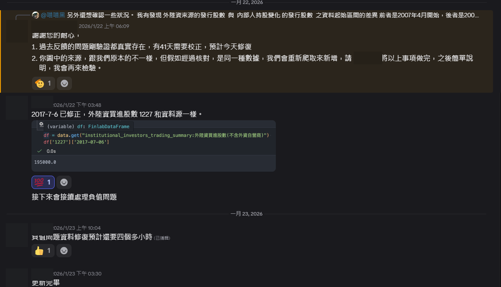

[← 回到作品集首頁](../README.md)

# 金融資料品質案例｜FinLab

**性質／角色：** 個人研究　·　**研究期間：** 2026.01–2026.04

本頁整理本人在研究期間發現並回報的特定歷史資料案例，用於展示金融資料驗證、交叉確認與問題回報流程；內容只描述具體案例，不代表對 FinLab 整體資料品質或服務的評價。

> **主要結論：** 在台股機器學習研究中發現歷史財報缺漏、法人資料欄位錯位與不可能負值，透過公開資訊觀測站（MOPS）／XBRL、臺灣證券交易所（TWSE）與欄位規則建立可重現案例，其中部分問題後續獲平台確認與修正。

## 研究問題

當金融資料出現歷史缺漏、欄位錯位或不可能數值時，如何確認問題來自資料，而不是模型、特徵工程或欄位理解？如果異常成立，又如何把發現整理成平台能夠重現與修正的案例？

## 我做了什麼

- 先檢查欄位結構（schema）、日期範圍、缺值與不可能數值。
- 以欄位恆等式、單位與分類定義進行一致性檢查。
- 使用公開資訊觀測站（MOPS）／XBRL、臺灣證券交易所（TWSE）原始資料與公司事件交叉確認。
- 把股票、日期、季度、欄位與預期值整理成最小可重現案例後回報。
- 將確認後的規則加入上游檢查，避免異常直接進入特徵與模型。

## 主要結果

三類案例分別對應資料完整性、跨欄位一致性與合理值域檢查。部分案例由平台人員確認，另有一案由平台自動支援系統（BOT）重現並回覆修正。Discord 圖片只作輔助證據；案例成立的主要依據仍是可重現條件與官方來源交叉驗證。

## 案例一（DQ-01）— 歷史財報缺漏與 XBRL 回補

### 問題

部分股票的歷史財報科目出現跨季缺漏。如果只檢查單一欄位，無法判斷是公司未申報、平台沒有收錄，或整批歷史資料不完整。

### 驗證

我以股票與季度為單位檢查財報資料完整性，再逐筆對照公開資訊觀測站（MOPS）／XBRL 原始申報，確認公開財報存在而平台對應資料為空值。這類缺漏會改變基本面特徵、缺值訊號與可用訓練樣本。

### 結果

平台人員先確認問題；後續回覆稱已處理 2015Q1–2018Q4 的歷史回補。150 個科目、增加 6,027 列資料與 228,073 個非空值均為平台回覆內容，不是本人獨立驗證的修復總量。

### 佐證資料

> **圖說：** 以股票／季度與公開資訊觀測站（MOPS）／XBRL 原始資料交叉確認後回報；平台人員後續確認問題。

> **圖說：** 平台回覆稱已完成歷史財報回補；期間、科目與增加資料量均為平台回覆內容。

## 案例二（DQ-02）— `買進 − 賣出 = 買賣超` 跨欄位一致性

### 問題

少量法人交易列不符合「買進股數減賣出股數等於買賣超股數」的基本欄位關係。若欄位整體向後錯位，多個法人交易流向特徵會一起受到污染，不能只把單一極端值裁剪後繼續建模。

### 驗證

我先用算術恆等關係掃描全量資料，再排除單位、法人分類與調整項差異，最後針對指定股票與日期對照臺灣證券交易所（TWSE）原始資料。

| 類別 | 發現的異常列 |
|---|---:|
| 投信 | 8 |
| 自營商－自行買賣 | 4 |
| 自營商－避險 | 16 |
| **合計** | **28** |

這是以算術恆等關係定位出的異常列，不是平台整體錯誤總數。

### 結果

平台自動支援系統後續重現欄位錯位，並回覆已完成資料修正／回補；此回覆來自平台自動支援系統，不等同真人工程師確認。

### 佐證資料

> **圖說：** 平台自動支援系統後續重現欄位錯位，並回覆已完成資料修正／回補。

## 案例三（DQ-03）— 法人買進負值與特定日期錯值

### 問題

法人買進股數曾出現不可能的負值，另有股票代號 1227／2017-07-06 的特定歷史數值與官方來源不一致。負值可能扭曲極端流向、滾動統計與模型分裂。

### 驗證

我以合理值域檢查掃描法人買進欄位，保留特定股票與日期的可重現查詢，並分別對照臺灣證券交易所（TWSE）原始資料。

### 結果

平台人員後續確認相關歷史問題，其中回覆提到有 41 個日期需校正；特定日期錯值與負值問題之後陸續修正。

### 佐證資料

> **圖說：** 平台人員確認先前回報問題確實存在，並說明特定日期與負值問題的後續處理。

## 研究流程後續加入的檢查

- **資料完整性：** 區分真實零值、未上市、未提供資料與異常缺值。
- **資料可得時點：** 確認欄位在模型決策時間已實際可取得。
- **合理值域檢查：** 攔截法人買進股數為負等不可能數值。
- **跨欄位一致性：** 驗證買進、賣出與買賣超等欄位關係。

## 原始問題回報與討論

完整 Discord 討論需登入帳號並加入該社群後才能閱讀。本頁已整理主要案例、交叉驗證與平台回覆；原始連結僅供需要進一步查閱者參考。

[查看原始 Discord 討論](https://discord.com/channels/897386624067969034/1462088675457499268)

## 延伸資料

- [Recruiter Portfolio PDF](../LIN_YU_HSUAN_QUANT_ML_PORTFOLIO.pdf)
- [Technical Appendix](../LIN_YU_HSUAN_QUANT_ML_TECHNICAL_APPENDIX.pdf)
- [Public Code](https://github.com/sean33885566/quant-ml-research)

[← 回到作品集首頁](../README.md)
