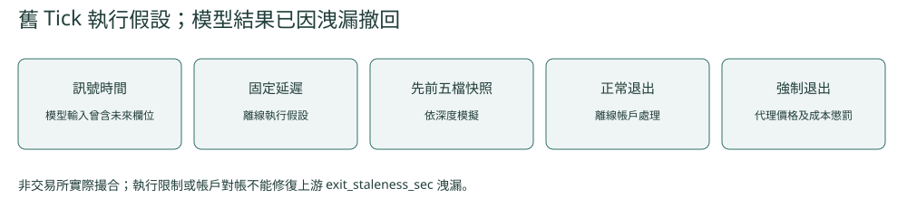
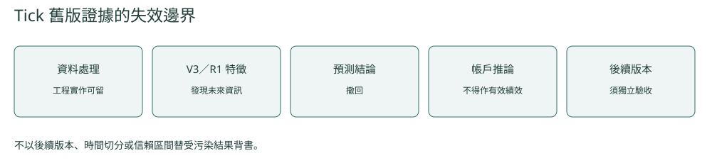

[← 回到作品集首頁](../README.md)

# 台股日內 Tick 機器學習研究

**性質／角色：** 個人研究　·　**研究期間：** 2026

> **主要結論：** 以逐筆成交與五檔資料建立的日內模型呈現部分樣本外預測證據；在時間、流動性、門檻與實際成交條件納入驗證後，高信心放空分支呈正向點估，但目前樣本與統計證據仍不足以確認穩定交易優勢。

## 研究問題

逐筆成交（Tick）與五檔委託簿中的短期市場資訊，能否透過機器學習建立具有樣本外預測力的日內訊號，並在實際時間順序、流動性與成交限制下轉換成帳戶層結果？

## 研究範圍

- 約 6 個月、112 個交易日
- 每分鐘為主要決策頻率
- 15 分鐘為主要持有期
- 逐筆成交（Tick）與五檔委託簿
- LightGBM 回歸／三分類
- 1,000 萬元為主要事件帳戶

## 我做了什麼

從逐筆成交與五檔委託簿建立日內研究流程，分別測試回歸與三分類模型。除基礎成交與價格資訊外，擴充多檔委託簿、微價格（microprice）、成交強度、流動性恢復代理指標（resiliency proxy）與同步橫截面狀態等特徵，用於描述短期流動性與市場微結構狀態。

最終驗證流程以決策當下可交易股票建立時間一致的股票池（point-in-time, PIT），流動性使用前一交易日（T-1）資訊；模型門檻僅由先前已成熟的樣本外預測或各 fold 的校準期建立。訊號產生後於下一可成交時點進場，成交量受五檔委託簿容量限制，並以事件帳戶處理現金、同時持倉、同股不重疊、整張交易與正常／強制出場。

## 最終研究與驗證設計

| 研究環節 | 最終設定 | 目的 |
|---|---|---|
| 股票範圍 | 決策當下可交易股票（PIT） | 確保股票範圍與決策時間一致 |
| 流動性 | 前一交易日（T-1）資訊 | 只使用決策前可取得的流動性資訊 |
| 模型門檻 | 歷史已成熟樣本門檻／fold 校準門檻 | 不讀取測試期未來分布 |
| 進場 | 訊號後下一可成交時點 | 對齊訊號與實際執行順序 |
| 五檔委託簿 | 執行時間前最後可取得快照 | 維持委託簿資訊的時間一致性 |
| 成交容量 | 受五檔可成交量限制 | 納入日內流動性與容量條件 |
| 事件帳戶 | 現金、同時持倉、同股不重疊、整張交易及正常／強制出場 | 將模型訊號轉為帳戶層驗證 |

## 主要結果

### 模型層

回歸與三分類模型均呈現部分樣本外預測證據；兩個三分類版本能辨識部分做多／觀望／做空差異，但將預測轉換成交易動作並扣除成本後，平均交易效益仍為負。

### 事件帳戶層

回歸模型的高信心放空分支在 rolling threshold 設定下呈正向點估，共 98 筆交易、33 個出手日。

完整帳戶結果仍顯示較高的不確定性：該分支年化夏普比率為 0.444，但以 5 日移動區塊 bootstrap（5,000 次）計算的 95% 信賴區間為 `[-4.057, 2.876]`，跨越零。

因此目前較適合將結果解讀為：

> 日內資料中存在值得繼續驗證的預測訊號，但現有樣本尚不足以確認穩定的交易優勢。

## 這個專案完成了什麼

這個專案建立了從 Tick／五檔資料、日內特徵工程、LightGBM 模型，到時間與成交約束、事件帳戶及統計不確定性的完整驗證流程。

研究結果也顯示，模型的樣本外預測能力與帳戶層交易價值是不同層次的問題：即使模型能提供部分 predictive information，仍需要經過門檻、交易成本、流動性、容量與統計樣本數的進一步檢驗。

目前高信心放空分支提供值得後續追蹤的正向點估，但仍需更多未參與既有研究設計的全新後續資料（fresh-forward）確認穩定性。

<strong>技術細節：模型與最終回測設計</strong>

| 模型版本 | 模型設計 | 用途 |
|---|---|---|
| R1（多／空雙回歸） | 分別預測做多與做空的可成交淨報酬 | 供高信心門檻使用 |
| C1（基礎特徵三分類） | 預測做多／觀望／做空 | 以基礎日內特徵比較三種動作 |
| C2（擴充市場微結構特徵三分類） | 預測做多／觀望／做空 | 加入多檔委託簿、微價格、成交強度、流動性恢復代理指標與同步橫截面狀態 |

**成本後平均交易效益（action utility）：** 固定以一張（1,000 股）的可成交買賣報酬扣除買賣手續費與當沖證交稅後計算；不交易（FLAT）記為 0。模型層以每日橫截面平均衡量此指標。

### 最終驗證控制

| 控制項目 | 公開最終設計 |
|---|---|
| 股票池（Universe） | 決策當下可交易股票 |
| 流動性（Liquidity） | 前一交易日（T-1）資訊 |
| 門檻（Threshold） | 歷史已成熟樣本門檻／fold 校準門檻 |
| 進場（Entry） | 訊號後下一可成交時點 |
| 委託簿（Order book） | 執行前最後可取得五檔 |
| 容量（Capacity） | 五檔容量限制 |
| 出場（Exit） | 事件帳戶正常／強制出場；最晚 13:24 進入強制出場處理 |

<strong>技術細節：執行時序與證據層次</strong>

> **日內訊號與事件帳戶的最終執行時序**

<strong>技術細節：樣本外門檻與事件帳戶結果</strong>

事件帳戶比較兩種樣本外門檻設定：

- **歷史已成熟樣本門檻（rolling prior）：** 每個決策日僅使用先前已成熟的樣本外預測建立門檻。
- **Fold 校準門檻（fold calibration）：** 每個測試 fold 使用其前置校準期固定門檻。

並分別比較 all-signals 與 short-only 兩種方向設定。

| 策略 | 交易數 | 出手日 | 淨損益（元） | 年化報酬 | 年化夏普比率 | 交易勝率 | 夏普比率 95% 信賴區間 |
|---|---:|---:|---:|---:|---:|---:|---:|
| 歷史已成熟樣本門檻 — 全部訊號 | 165 | 51 | -12,566 | -0.37% | -0.183 | 49.1% | [-4.016, 2.141] |
| 歷史已成熟樣本門檻 — 僅做空 | 98 | 33 | +25,339 | +0.74% | 0.444 | 63.3% | [-4.057, 2.876] |
| Fold 校準門檻 — 全部訊號 | 228 | 58 | -81,264 | -2.36% | -1.181 | 46.9% | [-5.079, 1.573] |
| Fold 校準門檻 — 僅做空 | 121 | 43 | -76,567 | -2.23% | -1.234 | 52.9% | [-5.505, 2.059] |

四種事先定義的門檻／方向設定完整列示，以比較不同設定下的帳戶結果。歷史已成熟樣本門檻的僅做空分支呈正向點估，但樣本數仍少且夏普比率信賴區間跨零，因此現階段僅視為全新後續資料驗證的候選訊號。

## 延伸資料

- [Recruiter Portfolio PDF](../LIN_YU_HSUAN_QUANT_ML_PORTFOLIO.pdf)
- [Technical Appendix](../LIN_YU_HSUAN_QUANT_ML_TECHNICAL_APPENDIX.pdf)
- [Public Code](https://github.com/sean33885566/quant-ml-research)

[← 回到作品集首頁](../README.md)
