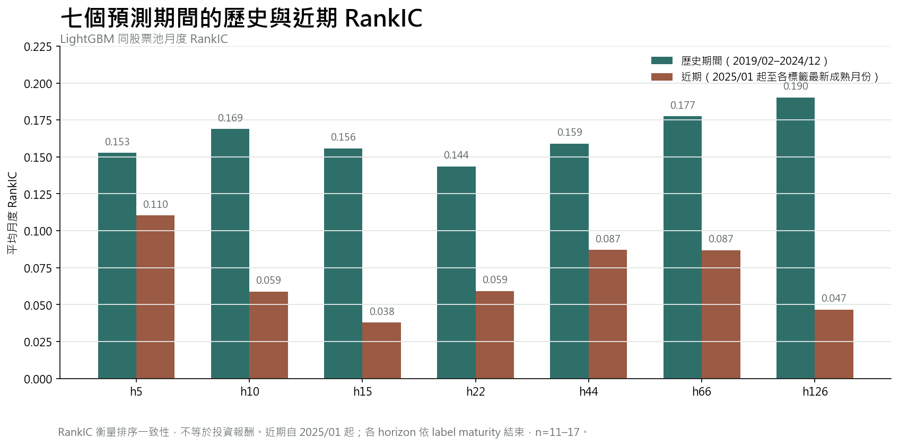
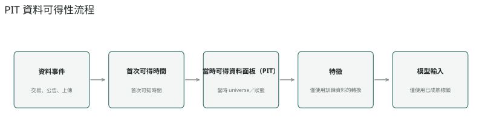
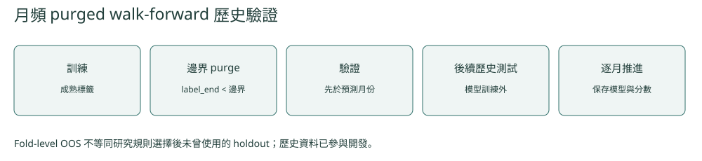
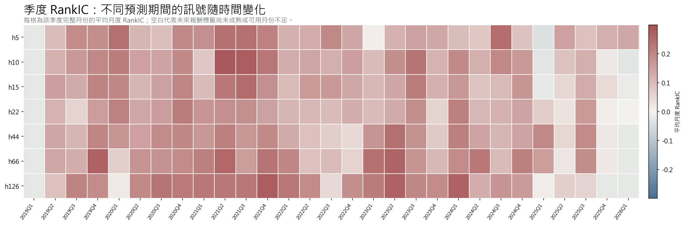
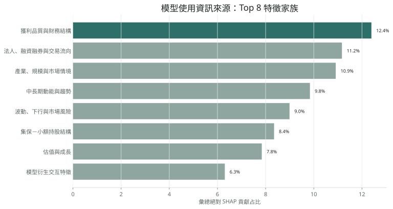

[← 回到作品集首頁](../README.md)

# 台股機器學習選股研究

**性質／角色：** 個人研究　·　**研究期間：** 2026.01–進行中

> **主要結論：** 歷史資料中存在橫截面排序訊號。h22（預測未來 22 個交易日）／10 億元固定切分研究在 2023/01–2026/03 正式評估期呈現可重現的正向相對績效；使用同一組固定投組權重改以 T+1 次一交易日調整後開盤價成交，結果仍為正。其他實務帳戶檢查顯示成果對資金、交易單位與比較基準定義敏感，因此不宣稱為可直接部署策略。

## 研究問題

台股的價量、財務與籌碼資料，能否讓機器學習模型排序未來表現相對較好的股票？如果排序能力存在，模型分數進入實際資金帳戶後，能否在成本、容量與替代投資的比較下保留價值？

這個專案把問題分成兩層：第一層檢查模型是否真的能排序股票；第二層再檢查排序訊號能否轉換成投資人可使用的績效。兩層結果分開報告，避免把漂亮的模型指標直接當成投資報酬。

## 重要名詞

- **樣本外（out-of-sample, OOS）：** 模型未用於訓練或調整的後續時間區間。
- **標籤成熟（label maturity）：** 未來報酬尚未完整實現前，不可作為訓練或校準目標。
- **模型血統（model lineage）：** 同一預測期間、資料切分與特徵流程所產生的一條可追溯模型與分數序列。
- **真正前瞻驗證（true-forward）：** 未參與既有模型、規則或門檻設計的後續新資料；本研究尚未累積到可作部署宣稱的 true-forward 證據。

## 我做了什麼

- 整合台股價量、財務、籌碼、交易狀態與市場情境資料。
- 依資料公告、上傳與交易時點建立 point-in-time 可得日，不用資料所屬期間代替實際可得時間。
- 以 LightGBM 測試未來 5、10、15、22、44、66、126 個交易日共 7 個預測期間。
- 每個預測期間執行 90 個 rolling / walk-forward folds，共管理 630 組模型結果。
- 以 SHAP 觀察模型使用的資訊來源與跨期變化。
- 將模型分數帶入投資組合，加入手續費、交易稅、整張交易、流動性、容量與持倉遞迴。
- 以 0050 買進持有和相同股票池市值權重投組回答不同的比較問題。

## 主要結果

模型在 2019/02–2024/12 的七個預測期間都呈現正向排序訊號；從 2025/01 起，多數期間仍為正，但強度較歷史水準偏弱。各 horizon 依 label maturity 結束於不同的最新成熟月份，因此近期結果用來描述壓力與時間變化，不解讀為永久失效。

投資組合層有兩層證據。h22／10 億元固定切分研究使用 2019/02–2022/12 作為投組規則選擇期，選定固定的市值傾斜規則後，在 2023/01–2026/03 正式評估期取得可重現的正向相對績效。後續的 1 億元實務帳戶檢查則未穩定保留相對優勢。這表示模型與投組流程曾產生可重現的歷史正結果，但成交、資金規模、交易單位與基準定義仍會實質影響經濟結論。

## 排序訊號

**RankIC（排序相關係數）**衡量模型預測排序與實際股票報酬排序的一致程度；它反映排序訊號，不等同投資報酬。

2019/02–2024/12 各 horizon 的平均月度 RankIC 約為 0.144～0.190，共 71 個月。近期區間自 2025/01 起，各 horizon 使用截至目前可取得的最新成熟月份，因此有效月份數為 11～17，平均約為 0.038～0.110。

## 投資組合結果

### h22 固定切分的正式評估結果

**名詞說明。** `h22` 是預測未來 22 個交易日；`固定切分` 是在選擇期固定投組規則後，不再依正式評估期結果調整；`正式評估期` 指規則選定後的獨立歷史評估區間；`固定投組權重（frozen weights）` 指已鎖定、不再依評估結果調整的每期目標權重。

| 研究口徑 | 策略年化報酬（CAGR） | 原研究基準年化報酬（CAGR） | 相對基準資訊比率（Active IR） | 策略淨值倍數 | 基準淨值倍數 |
|---|---:|---:|---:|---:|---:|
| h22／10 億元／正式評估期 2023/01–2026/03 | 35.30% | 31.95% | 1.326 | 2.6712x | 2.4622x |

這個結果使用原始固定切分研究契約：2019/02–2022/12 為投組規則選擇期；2023/01–2026/03 為正式評估期；原始成交口徑為訊號日調整後收盤價（signal-date adjusted close）；基準為同一市值前 40% 股票池的市值權重核心組合，並非 0050。鎖定後的策略權重與績效指標可重現。

固定市值傾斜規則以市值前 40% 股票池為範圍，先建立市值權重核心組合，再將當期模型分數做橫截面標準化，以核心權重乘上分數傾斜形成連續目標權重；舊研究產物中的傾斜係數固定為 1。其後施加單一股票與台積電各 10% 的主動權重限制、單邊 15% 換手限制及流動性限制，並投影至可行的權重集合。這是規則式市值傾斜，不是共變異數或 Markowitz 最佳化。

以同一組固定投組權重，只將成交時點改為 T+1 次一交易日調整後開盤價（T+1 adjusted open）做敏感度測試時，10 億元整張版本的 Active IR 仍為正（0.588）。這是成交時點敏感度測試，不是實務 0050 帳戶驗證，也不是實盤部署證據。

<strong>其他實務帳戶敏感度檢查</strong>

另在 h44／1 億元等實務帳戶契約下檢查成本、容量、0050 與同股票池市值權重基準；部分代表性設定未維持 h22 固定切分的相對優勢，顯示投組建構、資金規模與基準定義會明顯影響經濟結果。

| 比較對象 | CAGR | Sharpe |
|---|---:|---:|
| 代表性模型投資組合 | 19.16% | 1.046 |
| 同股票池市值權重基準 | 20.35% | 1.090 |
| 0050 買進持有 | 21.41%～22.12% | 1.108～1.102 |

此 h44／100M 檢查納入成本與容量。同股票池基準使用相同執行假設；0050 的配息入帳時點以兩條合理路徑重建，因此以範圍呈現。

## 我從這個專案得到什麼

模型的正向 RankIC 是研究起點，不是策略終點。只有在資料時點、樣本外驗證、交易成本、資金容量與比較基準都一致時，才能判斷模型是否產生投資價值。這套流程也讓我能主動辨識「模型看起來有效，但投資組合沒有保留訊號」的情況，而不是只保留較漂亮的回測結果。

<strong>技術細節：資料與時間點（Point-in-Time, PIT）處理</strong>

- 財務資料依公告或平台上傳後的實際可用時間進入特徵，不在財報所屬季度提前使用。
- 上市櫃狀態、交易限制與缺值狀態依當時可知資訊建立，避免使用事後完整股票池。
- 訓練資料只納入已成熟的未來報酬 label；validation 與 test 依時間順序隔離。
- 橫截面轉換、裁剪與校準只使用訓練期或前期已成熟資料。

<strong>技術細節：Walk-forward Validation 與訊號時間穩定性</strong>

每個 fold 依時間切分訓練集（train）、驗證集（validation）與測試集（test）；未來報酬尚未成熟的樣本不進入訓練。模型選擇與資料轉換只使用該測試期之前的資訊，再逐期產生樣本外預測。

| Horizon | 2019/02–2024/12 RankIC | 2025/01 起 RankIC | 近期月份 |
|---|---:|---:|---:|
| h5 | 0.153 | 0.110 | 17 |
| h10 | 0.169 | 0.059 | 17 |
| h15 | 0.156 | 0.038 | 17 |
| h22 | 0.144 | 0.059 | 17 |
| h44 | 0.159 | 0.087 | 15 |
| h66 | 0.177 | 0.087 | 14 |
| h126 | 0.190 | 0.047 | 11 |

季度圖沿用同一 monthly RankIC 指標與模型 lineage；每格只在該季度三個月份都完整時取平均，用來觀察訊號隨時間的變化，而不是重複比較兩段平均值。

近期多數 horizon 較歷史期間偏弱，但期間內仍可觀察到短期回升，並未呈現所有 horizon 同步、永久失效的型態。

<strong>技術細節：SHAP 與特徵分析</strong>

特徵涵蓋法人、融資融券與交易流向，價量與流動性，財務結構與獲利品質，估值與成長，集保持股級距，以及產業、規模與市場情境。SHAP 以 630 組 rolling model results 聚合絕對貢獻，用於了解模型主要使用哪些資訊；它不是因果效果。

<strong>技術細節：成本、流動性與 Benchmark</strong>

- 模型 score 先形成相對選股訊號，不把 RankIC 當成報酬率。
- 投組回放納入手續費、交易稅、整張限制、流動性、容量與前期實際持倉。
- 100 萬、1,000 萬、1 億與 10 億元分別實跑，不以線性比例外推容量。
- 0050 回答投資人機會成本；同股票池市值權重基準回答 AI 是否增加選股價值。
- 2019–2026 已反覆用於研究，仍需要未參與既有設計的全新後續資料（true-forward）確認穩定性。
- 2019/02–2022/12 的 monthly LightGBM predictions 仍由 rolling / walk-forward 產生，可視為模型訊號層 OOS；但 final h22 portfolio rule 使用這段期間選出，因此這段不是該投組規則的 formal OOS。

## 延伸資料

- [Recruiter Portfolio PDF](../LIN_YU_HSUAN_QUANT_ML_PORTFOLIO.pdf)
- [Technical Appendix](../LIN_YU_HSUAN_QUANT_ML_TECHNICAL_APPENDIX.pdf)
- [Public Code](https://github.com/sean33885566/quant-ml-research)

[← 回到作品集首頁](../README.md)
